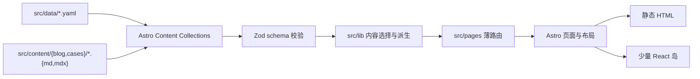

# 项目架构

本项目是静态优先的中文个人主页。Astro 负责路由、数据加载、Markdown/MDX 和页面组合；React 只承载需要浏览器状态的交互；Tailwind CSS 与 shadcn/ui 提供样式和基础组件。

## 数据流

配置和内容只通过 Content Collections 进入页面。schema 负责字段形状和基础约束，内容模块负责草稿过滤、排序、分页、标签与搜索，页面组件接收已经确定的数据并渲染。

## 目录职责

| 目录 | 职责 |
| --- | --- |
| `src/data/` | 站点、音乐、About 和项目 YAML 配置 |
| `src/content/blog/` | 博客 Markdown 与 MDX |
| `src/content/cases/` | 与项目一对一关联的案例 Markdown 与 MDX |
| `src/lib/config/` | Content Collections 使用的 Zod schema |
| `src/lib/content/` | 博客、项目、案例关联、封面、分页、搜索和阅读时间逻辑 |
| `src/pages/` | 薄路由入口和静态路径生成 |
| `src/layouts/` | HTML 文档、侧栏壳和文章壳 |
| `src/components/astro/` | 页面级组合与静态内容组件 |
| `src/components/react/` | shadcn 展示组件和浏览器交互 |
| `src/config/routes.ts` | 路由配置、类型和公开路径生成 |
| `src/lib/ui.ts` | 中文文案、占位符替换与日期格式化 |
| `src/lib/comments/` | 评论配置分发、懒加载、重试和清理 |
| `src/styles/` | 全局、布局、列表、文章和评论样式 |

## 页面与组件边界

路由文件只负责调用 `getStaticPaths()` 或传入页面 props。页面内容在 `src/components/astro/pages/` 组合，公共页面框架由 `SidebarLayout.astro` 和 `BaseLayout.astro` 提供。

Astro 文件中没有 `client:*` 的 React 组件只生成静态 HTML。当前客户端边界是：

- `AppShell client:load`：管理侧栏、移动菜单、主题，以及启用后的音乐胶囊；播放器控件在挂载后按需导入，服务端和首次水合保持相同占位，不向客户端导航页面输出流式 Suspense 边界。
- 博客搜索岛：只在搜索页加载，接收构建期生成的最小文章元数据。
- 评论：不建立常驻 React 岛；评论区接近视口时动态导入 Waline 或 Twikoo 客户端。

列表、卡片、标签、分页、个人资料和 About 正文不应新增独立水合根。

博客与案例共用 `components/astro/content/` 中的正文、目录和阅读进度组件。博客文章壳负责发布日期、博客标签导航、评论与相邻文章；案例页面组合项目头部、外链和正文，不依赖博客文章壳，不新增水合根。首页保持介绍型布局。

## 未来交互模块

主站先在同一仓库和静态构建中维护模块边界。Astro 组织页面与静态内容，React 岛只承担需要浏览器状态的交互。模块自己管理状态、样式、资源和初始化／销毁过程，依赖在所在页面加载；完整工具与游戏进入独立功能页，首页只按实际需求加入轻组件。

AppShell 继续只管理侧栏、主题和音乐控制，业务状态留在所属功能。未来工具和游戏默认离页停止运行并释放 rAF、计时器、监听、音效和异步任务；必要进度保存在本地，返回后恢复暂停并由访客手动继续。只有明确需要跨页持续运行的功能才单独设计持久化节点，不持久化正文或整个 AppShell。

新功能同时兼容音乐开启时的客户端导航与关闭时的整页导航，复用页面生命周期工具。出现实际联网需求后再加入 Workers API；需要独立发布、独立账号或复杂持续会话的应用，再拆分应用与部署。当前不预建游戏引擎、全局业务 store、插件注册器、空 API 或数据库。

## 音乐与站内导航

音乐独立配置在 `src/data/music.yaml`，通过 `music` Content Collection 校验和加载，默认关闭。启用并配置有效歌单后，公共布局启用 Astro `ClientRouter`；只在 AppShell 外持久化一个无初始 `src`、`preload="none"` 的原生 `<audio transition:persist="site-music">`。页头控件复用 AppShell，通过浏览器端音乐控制模块订阅音频状态，组件卸载不停止音频。AppShell、正文和搜索岛在换页时正常更新，避免将页面 slot 一同持久化。

音乐配置只需标题、歌手、音源和可选封面；音源 `src` 不可重复，直接作为内部曲目标识，调整顺序或修改展示信息不影响身份。播放顺序、随机队列、历史及错误跳过由 `src/lib/music/` 管理。首次点击播放才设置音源。浏览器存储仅保存曲目标识（音源地址）、进度、音量和模式，刷新后保持暂停；存储不可用时仍可播放。禁用音乐时不启用客户端导航、不渲染音频节点或胶囊，也不下载播放器控件。

页面局部脚本使用 `onPageLifecycle`：首次加载与 `astro:page-load` 初始化，`astro:before-swap` 和 `pagehide` 清理，浏览器恢复缓存页面后重新初始化。文章目录和进度需取消 rAF、移除监听并断开 Observer；评论需调用提供商清理函数，包括处理异步加载期间离开页面的情况。主题、favicon 和侧栏偏好在 `astro:after-swap` 重施。搜索修改查询参数时保留 `history.state`，以兼容路由的后退和滚动恢复。

## 内容与路由

站点只提供中文页面，所有路径均不带语言前缀。公开路径统一通过 `src/config/routes.ts` 生成。HTML 和评论客户端使用 `zh-CN`，日期使用中文格式并固定为 UTC。

博客使用必填 `slug` 作为稳定标识，由 Astro 原生 glob loader 设置条目 ID。标识重复时构建失败，草稿不进入路由、列表、搜索或标签。文章按自身发布日期降序排列，同日按 slug 排序。项目直接保存标题与简介，按年份降序、同年按 ID 排序。

案例通过 `projectId` 关联项目 YAML，每个项目至多一个案例。案例只维护稳定 slug、发布状态、目录开关和正文，标题、摘要、年份、标签、封面与外链来自项目。包括草稿在内的重复 slug、重复关联和缺失项目均在构建期报错。只有已发布案例生成 `/projects/{slug}` 和项目卡片的 `caseHref`；原有项目外链不被替换，案例不进入博客列表、标签或搜索。

案例的写作与发布规则参见[作品案例](portfolio.md)。

## 部署边界

主要部署入口是 Workers Static Assets：Astro 构建 `dist/`，Wrangler 验证并发布，请求直接读取静态资源，未知路径返回 404，HTML 地址统一不带末尾斜杠。当前没有 Worker 服务端入口、运行时绑定或 Cloudflare adapter。canonical 与 Open Graph 沿用 Astro 的站点地址，不根据访问域名临时改写。

Cloudflare 原生 Workers Builds 负责 Git 自动部署，生产分支为 `master`，非生产分支按需启用云端预览。GitHub Actions 只检查，不持有部署凭据或重复发布。所有入口共用 `pnpm verify` 的串行检查与构建流程；Wrangler 配置只声明托管与预览行为，不依赖平台不会采用的 custom build。版本、控制台设置、预览与回滚见[部署说明](deployment.md)。

未来需要 API 时可加入按路径处理的 Worker 服务；只有 Astro 自身需要按需服务端渲染时才引入适配器。

中文文章 URL 和评论标识均使用 `/blog/{slug}`。旧 `/en` 地址不生成页面或跳转。页面保留 canonical 与 Open Graph URL，不输出 hreflang。

`site.yaml` 中的 `navigation` 只决定侧栏入口和顺序。新增公开页面仍通过 Astro 文件路由实现；如果需要加入主导航，再同步扩展路由配置、中文文案和导航 schema。

## 性能约定

- 默认生成静态页面，不引入 SSR 或运行时内容查询。
- 构建期可确定的状态留在 Astro，不为静态卡片和列表增加 `client:*`。
- 搜索元数据不包含正文或封面，也不进入其他页面。
- 评论客户端在接近评论区时加载，并保留失败重试与卸载清理。
- 图片封面交给 Astro 内容图片能力处理；生成式等高线在构建期输出。

## 样式归属与加载

全局入口只引入 Tailwind、shadcn、字体、主题 token、基础样式和公共布局样式。页面与组件在自己的入口声明功能样式，常规 CSS 由 Astro 原生分包并复用；调整加载入口时保留选择器、CSS layer 和声明，避免改变视觉与覆盖关系。

| 样式 | 所属入口 |
| --- | --- |
| 首页背景、社交链接 | HomePage、SocialLinks 的原生全局样式块 |
| 列表、卡片、分页 | 博客列表、项目列表、标签和搜索页面 |
| About | AboutPage |
| 封面与配色变量 | Cover |
| 正文、目录、进度、相邻文章 | MarkdownDocument |
| 评论容器、加载与错误提示 | 实际渲染的 Comments |
| 音乐胶囊与控制面板 | 动态加载的 MusicCapsule |

列表样式不包含 About 或封面规则，文章页不会因使用封面而引入列表样式。评论容器和音乐样式使用 Vite `?inline` 导入处理后的 CSS 字符串，在所属组件内输出原生 `<style>`，避免条件功能样式被提前合并进全站 CSS。评论容器样式随静态评论区域输出，提供商客户端和样式仍在接近视口时加载；音乐样式随现有控件模块加载，不改变挂载时机或增加水合根。

样式边界调整后，除测试、类型检查和构建外，还需检查生成 HTML 的外链与内联样式，确认各页面只包含所需功能规则，并通过临时关闭音乐、文章评论进行构建对照。体积比较应同时统计外链 CSS、内联 CSS 和音乐模块携带的 CSS，不能只比较公共文件大小。桌面、手机、主题、站内换页及前进后退的视觉与交互仍由人工验收，不执行自动截图。

## 修改入口

- 个人资料、导航、评论和封面：参见[配置说明](configuration.md)。
- Markdown/MDX、标签和草稿：参见[博客写作](blogging.md)。
- 新增页面或调整组件边界：先遵循本页的数据流和客户端边界，再同步路由与测试。
