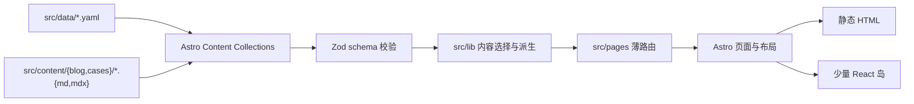

# 项目架构

本文维护数据流、组件边界、样式归属与生命周期。字段和用户操作见[配置说明](configuration.md)，验证步骤见[开发约定](development.md#自动检查与产物)，发布流程见[部署说明](deployment.md)。

Astro 负责构建期数据加载、Markdown/MDX、路由和页面组合；React 承载需要浏览器状态的交互；Tailwind CSS 与 shadcn/ui 提供样式和基础组件。

## 数据流

配置和内容只通过 Content Collections 进入页面。schema 负责字段形状和基础约束，内容模块负责草稿过滤、排序、分页、标签与搜索，页面组件接收已经确定的数据并渲染。

## 目录职责

| 目录 | 职责 |
| --- | --- |
| `src/data/` | 站点、音乐、About、项目和相册 YAML 配置 |
| `src/content/blog/` | 博客 Markdown 与 MDX |
| `src/content/cases/` | 与项目一对一关联的案例 Markdown 与 MDX |
| `src/lib/config/` | Content Collections 使用的 Zod schema |
| `src/lib/content/` | 博客、项目、案例关联、相册、封面、分页、搜索和阅读时间逻辑 |
| `src/pages/` | 薄路由入口和静态路径生成 |
| `src/layouts/` | HTML 文档、侧栏壳和文章壳 |
| `src/components/astro/` | 页面级组合与静态内容组件 |
| `src/components/react/` | shadcn 展示组件和浏览器交互 |
| `src/config/routes.ts` | 路由配置、类型和公开路径生成 |
| `src/lib/ui.ts` | 中文文案、占位符替换与日期格式化 |
| `src/lib/comments/` | 评论配置分发、懒加载、重试和清理 |
| `src/styles/` | 全局样式与各功能模块的样式 |

## 页面与组件边界

路由文件只负责调用 `getStaticPaths()` 或传入页面 props。页面内容在 `src/components/astro/pages/` 组合，公共页面框架由 `SidebarLayout.astro` 和 `BaseLayout.astro` 提供。

Astro 文件中没有 `client:*` 的 React 组件只生成静态 HTML。当前客户端边界是：

- `AppShell client:load`：管理侧栏、移动菜单、主题，以及启用后的音乐胶囊；播放器控件在挂载后按需导入，服务端和首次水合保持相同占位，不向客户端导航页面输出流式 Suspense 边界。
- 博客搜索岛：只在搜索页加载，接收构建期生成的最小文章元数据。
- 评论：不建立常驻 React 岛；评论区接近视口时动态导入 Waline 或 Twikoo 客户端。

构建期可确定的状态留在 Astro；列表、卡片、标签、分页、个人资料和 About 正文保持静态输出。搜索只接收标题、摘要和标签，搜索元数据只进入搜索页；封面由 Astro 图片能力处理，等高线在构建期生成。

博客与案例共用 `components/astro/content/` 中的正文、目录和阅读进度组件。博客文章壳负责发布日期、博客标签导航、评论与相邻文章；案例页面组合项目头部、外链和正文，不依赖博客文章壳，不新增水合根。首页保持介绍型布局。

## 相册

`src/data/albums.yaml` 通过 `albums` Content Collection 加载。原生 glob loader 将完整根对象作为单个条目校验，加载前检查必需文件存在，避免零匹配时沿用缓存。`src/lib/content/albums.ts` 按配置顺序选择公开相册、解析封面并生成静态路径；字段和草稿约束见[相册配置](configuration.md#相册配置)。

`AlbumsPage` 组合目录与 `AlbumCard`，`AlbumPage` 组合照片墙与 `AlbumViewer`；两者均由 Astro 输出，不增加 React 水合根。`PhotoImage` 统一处理本地响应式图片与远程原生图片，构建不抓取远程尺寸或资源。布局与元数据的展示位置见[相册展示与灯箱](configuration.md#展示与灯箱)。

详情页独占 `src/lib/albums/` 中的瀑布流和灯箱脚本。瀑布流保留 DOM/配置顺序，逐张放入当前最短列；图片加载前保留非零占位，缓存命中、加载失败及尺寸变化都会触发合并重排。图片加载后以实际高度排布，首次加载允许布局变化；无 JavaScript 时保留原比例网格与原图链接。

灯箱使用原生 `<dialog>`，关闭时恢复焦点与滚动状态；离页时释放滚动锁并忽略过期图片回调，恢复缓存页面时重新挂载。监听、Observer 与 rAF 使用[页面生命周期](#页面生命周期)统一清理。相册状态留在详情页，不进入 AppShell 或跨页持久化。

相册按 200 张以内的精选内容设计，不设照片数量硬上限；分页、搜索、标签、评论、上传后台与自定义双指缩放需作为独立需求设计。

## 未来交互模块

主站先在同一仓库和静态构建中维护模块边界。Astro 组织页面与静态内容，React 岛只承担需要浏览器状态的交互。模块自己管理状态、样式、资源和初始化／销毁过程，依赖在所在页面加载；完整工具与游戏进入独立功能页，首页只按实际需求加入轻组件。

AppShell 继续只管理侧栏、主题和音乐控制，业务状态留在所属功能。未来工具和游戏默认离页停止运行并释放 rAF、计时器、监听、音效和异步任务；必要进度保存在本地，返回后恢复暂停并由访客手动继续。只有明确需要跨页持续运行的功能才单独设计持久化节点，不持久化正文或整个 AppShell。

新功能同时兼容音乐开启时的客户端导航与关闭时的整页导航，复用页面生命周期工具。出现实际联网需求后再加入 Workers API；需要独立发布、独立账号或复杂持续会话的应用，再拆分应用与部署。当前不预建游戏引擎、全局业务 store、插件注册器、空 API 或数据库。

## 音乐与站内导航

音乐独立配置在 `src/data/music.yaml`，通过 `music` Content Collection 校验和加载，默认关闭。启用并配置有效歌单后，公共布局启用 Astro `ClientRouter`；只在 AppShell 外持久化一个无初始 `src`、`preload="none"` 的原生 `<audio transition:persist="site-music">`。控件复用 AppShell，通过浏览器端音乐控制模块订阅音频状态，组件卸载不停止音频。AppShell、正文和搜索岛在换页时正常更新，避免将页面 slot 一同持久化。

`src/lib/music/` 管理播放顺序、随机队列、历史与错误跳过，音源 `src` 直接作为曲目标识。首次点击播放才设置音源。播放记录使用 `homepage.music.v1`，仅保存曲目标识、进度、音量和模式，刷新后保持暂停；存储不可用时仍可播放。禁用音乐时不启用客户端导航、不渲染音频节点或胶囊，也不下载播放器控件。

桌面配置沿 `music` 集合 → Astro 布局 → AppShell view model → MusicCapsule 传递。桌面控件通过 body portal 显示，避开页头 `backdrop-filter` 对 fixed 定位的影响。浮层只占自身区域，胶囊层级 30、控制面板 40，低于模态弹层 50。`useMusicDock` 读取 `#main-content` 的实际边界，使用 ResizeObserver 和视口 resize 跟随侧栏与窗口变化，通过 rAF 合并测量；卸载时断开观察、移除监听并取消待执行任务。面板锚定完整胶囊，按左右位置向上对齐。

`src/lib/music/ui-preference.ts` 独立管理 `homepage.music.ui.v1` 的位置与收起偏好，有效记录覆盖站长默认，损坏记录回退默认，初始化只读。浏览器单例在存储不可用时保留当前会话选择，服务端不共享访客状态；不改变 `homepage.music.v1` 的播放记录格式。音乐模块仍挂载后动态导入，确认断点与偏好后才显示桌面浮层，CSS 仍通过 `?inline` 加载，不新增水合根。

收起、展开、左右切换与跨断点只改变 UI，不重建音频或加载音源。手机保留但忽略桌面偏好。跨断点关闭面板，焦点原在控件内才转移到新入口；收起后聚焦侧边恢复入口，展开后面板保持关闭。面板打开状态不持久化，AppShell 换页重建后默认关闭；播放单例和原生音频继续运行。

`MusicCapsule` 管理播放订阅、断点、弹层、焦点和详情展开状态；`MusicControls` 及其歌单、设置展示组件只接收状态与操作。切换位置保持面板、当前详情与焦点。入口与面板的展示契约见[音乐配置](configuration.md#音乐配置)。

## 页面生命周期

页面局部脚本使用 `onPageLifecycle`：首次加载与 `astro:page-load` 初始化，`astro:before-swap` 和 `pagehide` 清理，浏览器恢复缓存页面后重新初始化。文章目录和进度需取消 rAF、移除监听并断开 Observer；评论需调用提供商清理函数，包括处理异步加载期间离开页面的情况。主题、favicon 和侧栏偏好在 `astro:after-swap` 重施。搜索修改查询参数时保留 `history.state`，以兼容路由的后退和滚动恢复。

## 内容与路由

站点只提供中文无前缀页面，公开路径统一通过 `src/config/routes.ts` 生成，不输出英文页面、旧 `/en` 跳转或 hreflang。HTML 和评论客户端使用 `zh-CN`，日期使用中文格式并固定为 UTC。页面保留 canonical 与 Open Graph URL。

博客条目由原生 glob loader 以 frontmatter `slug` 设置 ID，内容模块使用同一个已发布集合生成路由、列表、标签、搜索和相邻文章。标识与排序规则见[博客写作](blogging.md)。

案例内容模块负责与项目关联、过滤草稿，并派生项目卡片的 `caseHref`；案例页组合项目头部和公共正文，不复用博客文章壳。关联、字段来源与公开行为见[作品案例](portfolio.md)。

## 部署边界

主要部署入口是 Workers Static Assets：Astro 构建 `dist/`，Wrangler 验证并发布，请求直接读取静态资源，未知路径返回 404，HTML 地址统一不带末尾斜杠。当前没有 Worker 服务端入口、运行时绑定或 Cloudflare adapter。canonical 与 Open Graph 沿用 Astro 的站点地址，不根据访问域名临时改写。

自动发布、控制台设置、分支预览与回滚统一在[部署说明](deployment.md)维护；验证命令与本地进程管理在[开发约定](development.md)维护。

未来需要 API 时可加入按路径处理的 Worker 服务；只有 Astro 自身需要按需服务端渲染时才引入适配器。

## 样式归属与加载

全局入口只引入 Tailwind、shadcn、字体、主题 token、基础样式和公共布局样式。页面与组件在自己的入口声明功能样式，常规 CSS 由 Astro 原生分包并复用；调整加载入口时保留选择器、CSS layer 和声明，避免改变视觉与覆盖关系。

相册和音乐以模块内的黑白灰、细边框、8px 面板圆角与胶囊按钮转译 [DESIGN.md](../DESIGN.md)。复用项目 token 和现有字体适配浅深主题，模块不使用阴影或装饰渐变，也不覆盖全站 token 或基础组件公共 API。

| 样式 | 所属入口 |
| --- | --- |
| 首页背景、社交链接 | HomePage、SocialLinks 的原生全局样式块 |
| 列表、卡片、分页 | 博客列表、项目列表、标签和搜索页面 |
| About | AboutPage |
| 相册目录、照片墙与灯箱 | AlbumsPage、AlbumPage |
| 封面与配色变量 | Cover |
| 正文、目录、进度、相邻文章 | MarkdownDocument |
| 评论容器、加载与错误提示 | 实际渲染的 Comments |
| 音乐胶囊与控制面板 | 动态加载的 MusicCapsule |

列表样式不包含 About 或封面规则，文章页不会因使用封面而引入列表样式。评论容器和音乐样式使用 Vite `?inline` 导入处理后的 CSS 字符串，在所属组件内输出原生 `<style>`，避免条件功能样式被提前合并进全站 CSS。评论容器样式随静态评论区域输出，提供商客户端和样式仍在接近视口时加载；音乐样式随现有控件模块加载，不改变挂载时机或增加水合根。

样式加载改动的产物检查见[按场景检查产物](development.md#按场景检查产物)，视觉与交互见[人工验收](development.md#人工验收)。

## 修改完成条件

新增页面或调整组件边界后，逐项确认：

1. 数据在 schema、内容模块、薄路由和展示组件各有明确归属；新增公开入口已同步路由、中文文案及所需导航 schema。
2. 状态、水合、依赖加载、持久化与离页清理符合上述边界。
3. 本文已记录新增的长期边界；按[开发约定](development.md#自动检查与产物)完成适用验证，人工验收状态已单独说明。
