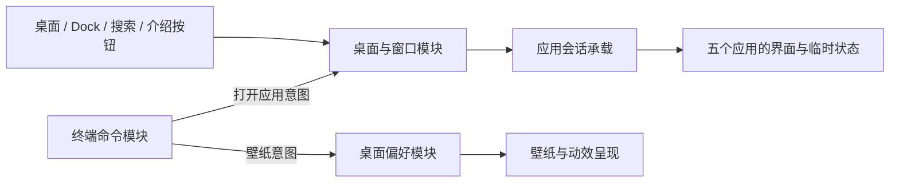

# HonestOS 设计

状态：首版实现已完成。2026-10-23 的后续视觉与架构调整已确认，冲突处以 [macOS 风格细化](macos-refinement.md) 为准；博客文章手动精选，见 [ADR-0003](../adr/0003-manually-curated-blog-posts.md)。

实现规格：[HonestOS v1：实现桌面式个人主站与五应用交互（#1）](https://github.com/honestman9527/homepage/issues/1)，标签为 `ready-for-agent`。实施范围与验收要求以该规格为准，本文件保留设计理由与视觉基线。

本设计基于用户提供的 v1.0 需求与同版交接包，并记录后续访谈结论。两份原始参考资料仅保留在本地，不纳入提交；本设计、[词汇表](../../GLOSSARY.md) 与 ADR 承载仓库中的设计结论。

## 定位与首版边界

HonestOS 是 honestman.me 的个人主站。访客通过桌面认识作者、浏览项目、找到独立博客；终端是可选的探索入口，主要任务均有可见导航。

首版保留紫灰暮色山峦壁纸、米白内容窗口、深色终端、菜单栏、桌面快捷入口和 Dock。主标题为“保持好奇，持续折腾。”，品牌使用 HonestOS / honestman / H.。

应用固定为关于我、我的项目、随便写写、终端、桌面设置。每个应用最多一个实例，支持打开、聚焦、关闭，以及桌面模式下的最小化、拖动、缩放、最大化与恢复。

首版还包括应用搜索、三套壁纸、动效偏好、小屏适配、基础可访问性、异常降级、核心逻辑定向测试和手动发布流程。深链、窗口布局跨刷新恢复、额外彩蛋与访问统计留作后续增强。

首版不包含账户、CMS、数据库、真实 Shell、远程管理、在线代码执行、AI 聊天或 3D 星系；独立博客和其他个人项目不在本仓库建设。

## 视觉与导航基线

关于我保留以下文案：

- 介绍：“我是 honestman，也叫爱睡觉的老实人。”
- 简介：“一个学生，喜欢把脑海里的「要不试试」变成互联网上真实存在的小东西。”
- 兴趣：Web 开发、AI 探索、NAS / OpenWrt。
- 主操作“看看我在折腾什么”打开项目；次操作“或者，敲点命令”打开终端并明确聚焦输入。

从原型提取的视觉值作为正式样式起点：

| 元素 | 原型基线 | 正式设计约束 |
| --- | --- | --- |
| 正文与内容背景 | `#292830` / `#fcfaf7` | 正文面板保持阅读所需不透明度 |
| 辅助文字与分隔线 | `#8b8790` / `#eae7e9` | 提高必要文字与控件对比度，原型数值不代表已达标 |
| 暮色壁纸 | `#77708e` → `#c28ba3` → `#e6b79e` | 保留山峦、柔和月亮和少量星点 |
| 晨光壁纸 | `#7fada9` → `#c6c6aa` → `#ecddae` | 只改变桌面背景，不另建内容主题 |
| 午夜壁纸 | `#101e34` → `#3b3c5e` → `#a27b98` | 同上 |
| 普通窗口 | 12px 圆角、浅边框、柔和大阴影 | 标题栏固定、内容区独立滚动 |
| 主按钮 | 背景 `#30352e`、文字 `#f5f3e9`、6px 圆角 | 可见焦点与足够触摸区域 |
| 终端 | 深色 `#22232be8`、浅文字 `#cfd2cf` | 保留等宽字体，长文本合理换行 |
| 菜单栏与 Dock | 原型菜单栏 36px、Dock 19px 圆角、46px 图标 | 玻璃质感集中在系统层，手机不靠缩小点击区适配 |
| 字体 | 系统无衬线与系统等宽字体栈 | 中文阅读优先，不引入远程字体作为首屏依赖 |

布局保留留白和窗口构图。原型的极小字号、低对比度与硬编码坐标只作参考，正式实现按可读性和几何约束调整；不引入强制开机动画、登录遮罩或自动音效。

应用注册表包含以下稳定身份与默认尺寸起点，实际尺寸均需约束到可用区域：

| ID | 名称 | 默认尺寸起点 |
| --- | --- | --- |
| about | 关于我 | 约 700×530px |
| projects | 我的项目 | 约 820×570px |
| blog | 随便写写 | 约 820×570px |
| terminal | 终端 | 约 470×290px |
| settings | 桌面设置 | 约 510×490px |

Dock 按关于我、我的项目、随便写写、终端、分隔线、设置、搜索排列。搜索是系统面板，不是第六个应用；点击活动应用只聚焦，不切换为关闭或最小化。

桌面右侧的项目、随笔、README.md 单击或键盘激活后分别打开项目、随笔、关于我。顶栏保留系统菜单、活动应用、导航、搜索、设置及访客本地时间；时间至少每分钟更新一次。小屏可隐藏桌面快捷入口并精简顶栏，Dock 始终提供完整应用入口。

## 已确认：主站与博客

主站与独立博客分开维护，理由见 [ADR-0001](../adr/0001-separate-blog-content.md)。随便写写应用只展示博客介绍、入口和可选的精选文章元数据，链接在新标签打开。

未配置博客地址时显示“独立博客筹备中”；原型示例文章不进入正式内容。主站不请求 RSS，也不提供站内文章阅读器。

## 已确认：技术方向

| 部分 | 选择 |
| --- | --- |
| 界面 | React + TypeScript，严格类型 |
| 构建 | Vite |
| 样式 | 普通 CSS / CSS Modules 与 CSS 变量，复用原型本地视觉资产 |
| 状态 | useReducer + Context，桌面状态与偏好分开 |
| 测试 | Vitest 等与 Vite 配合的定向逻辑测试 |
| 托管 | Cloudflare Workers Static Assets，只部署静态前端 |
| 发布 | GitHub Actions 手动 check / deploy，项目本地 Wrangler |
| 开发环境 | WSL2/Linux、pnpm、提交依赖锁文件 |

具体兼容稳定版本在实施时按官方文档和本地环境选择并锁定。首版只有根路径中的窗口交互，不为窗口切换增加页面路由或服务端业务接口。

选择依据：现有内容均可由静态配置提供，交互主要是浏览器内的窗口、搜索与命令状态。React 官方提供 [Vite 的 React/TypeScript 构建路径](https://react.dev/learn/build-a-react-app-from-scratch)，Cloudflare 支持 [静态资产托管](https://developers.cloudflare.com/workers/static-assets/)；当前需求可以沿此路径完成。

## 应用会话与呈现

应用会话是否存在、窗口是否可见、应用是否活动分别表达不同事实。单窗口模式下切换应用只改变前景，不结束旧应用会话。

| 动作 | 会话 | 呈现 |
| --- | --- | --- |
| 打开已关闭应用 | 创建默认会话 | 显示并置前 |
| 打开已运行应用 | 继续原会话 | 聚焦；最小化时先恢复 |
| 最小化 | 保留 | 隐藏窗口，保留 Dock 运行指示 |
| 关闭 | 结束并清理临时状态 | 移除窗口与 Dock 运行指示 |
| 手机切换应用 | 保留所有未关闭会话 | 仅活动应用位于前景 |
| 刷新页面 | 重新建立默认会话 | 恢复首访布局，只读取桌面偏好 |

终端输出、命令历史、输入草稿和阅读位置属于应用会话；壁纸和动效属于桌面偏好。窗口位置与大小本版不跨刷新保存。

初访桌面打开 About 和 Terminal，Terminal 位于前景但输入框不自动获取焦点；首访单窗口模式只打开 About。About 的介绍和主按钮应完整可见，Terminal 不遮挡主按钮。

## 已确认：整理桌面

整理桌面只恢复布局和前景安排，保留现有应用会话与桌面偏好。

- 桌面模式：About、Terminal 恢复默认位置、大小和普通窗口状态，Terminal 位于前景；其他仍在运行的应用最小化，保留会话与 Dock 运行指示。
- 单窗口模式：About 切到前景；其他已运行应用的会话保留，打开的应用留在后台，已最小化的应用仍可从 Dock 恢复。
- 默认布局需要的应用若已关闭，重新打开并创建新会话；已结束的旧会话不会复原。默认布局以外的已关闭应用保持关闭。
- 整理布局不主动聚焦终端输入框，终端的已有记录、草稿与阅读位置保持不变。
- 已最小化应用同样属于运行中的应用，其会话继续保留。桌面模式中的 About、Terminal 会恢复显示。

这明确了参考需求 DESK-05 的“恢复默认打开状态”：非默认应用不再因整理布局而关闭，终端以外的运行中应用也保留会话。

## 已确认：关闭活动应用后的去向

关闭应用时结束该应用会话，并从最近使用顺序中移除它。

- 桌面模式：将最近使用的其他 open 应用置前；没有候选时回到桌面。
- 单窗口模式：切回最近使用的其他 open 后台应用；没有候选时显示桌面、品牌与 Dock。
- minimized 应用的会话仍存在，但不会因关闭其他应用而自动恢复；访客可从 Dock 恢复它。
- 已关闭应用不会为了维持一个前景窗口而自动重开，About 也遵循这一规则。
- 焦点移交给后继窗口的可见目标；回到桌面时落到可见的导航入口，不留在已移除元素上。

上述后继选择仅在关闭或最小化活动应用时发生；关闭非活动应用不会改变原活动应用。

## 已确认：项目列表与详情

项目详情在我的项目窗口内替换列表内容，不创建额外窗口、应用或页面路由。

- 每张卡片通过明确操作进入详情；在线地址、源码地址是各自独立的链接。
- 详情提供“返回项目列表”，返回时恢复列表的原滚动位置，并把焦点交还给进入详情的卡片操作。
- 查看详情期间切换应用、最小化、跨桌面和手机模式、整理桌面，均保留该详情及阅读位置。
- 关闭我的项目后会话结束；重开从项目列表顶部开始。
- 若需要返回的项目已不在配置中，回到列表的有效位置与可见目标。

首版采用以下三个项目条目：

| 项目 | 简介 | 首版身份与状态 | 访问规则 |
| --- | --- | --- | --- |
| HonestOS | 把个人主页，变成一张可以探索的桌面。 | 本站作品，上线前为开发中；正式发布后可标已上线，同时保留“本站”标识 | 展示内部项目介绍，不用外链再次打开本站 |
| 小小宇宙 | 让好奇心，漫游到屏幕以外的星系。 | 构想中 | 仅展示已确认构想说明，无演示地址 |
| 实验室 | 给那些暂时没有名字的点子，留一个位置。 | 构想中 | 仅展示已确认构想说明，无演示地址 |

“本站”是身份标识，不增加第五种项目状态。项目本身保留已上线、开发中、构想中、归档四种状态；标记已上线的配置须提供真实在线地址，即使本站不渲染自链。

## 模块划分方向

每个模块通过少量明确操作向调用者提供完整行为，避免桌面图标、Dock、搜索与终端各自维护不同的应用清单或开窗规则。

| 模块 | 负责的事实与行为 | 调用者无需重复处理 |
| --- | --- | --- |
| 应用与内容配置 | 应用身份、名称、关键词、窗口尺寸、个人资料与项目和博客数据 | 复制应用列表、拼装缺失链接 |
| 桌面与窗口 | 打开、聚焦、最小化、关闭、最大化、整理，窗口顺序与几何约束 | 各入口自行切换可见性或计算层级 |
| 应用会话 | 各应用关闭前保留的临时使用状态 | 把最小化、后台切换误作关闭 |
| 终端命令 | 输入解析、命令结果、打开应用和更改壁纸等意图 | 直接操作窗口 DOM 或单独保存另一份偏好 |
| 桌面偏好 | 偏好读取、校验、默认值、持久化失败后的内存状态 | 各入口自行解析和写入存储 |
| 应用搜索 | 注册表匹配、选中项、模态键盘与焦点交接 | 为搜索建立另一套应用身份 |

窗口状态和几何约束、终端解析、搜索匹配、偏好校验可通过模块接口做定向测试。时钟、存储和指针等环境输入在相应入口处理；拖动中的高频坐标不要求每次都更新所有应用。

所有应用入口调用同一开窗操作，终端的 open 命令也沿此路径。应用注册表提供稳定 ID、中文名称、别名、搜索关键词、图标、默认尺寸和最小尺寸；增加应用时集中注册，不分别修改每个入口的清单。

### 窗口状态接口

窗口模块接受打开、聚焦、最小化、关闭、最大化切换、提交普通窗口几何、更新可用区域与整理桌面等操作。调用者给出应用身份和操作参数，模块统一维护以下不变量：

- 每个应用记录生命周期、会话身份、普通窗口几何和最大化状态；只有从 closed 打开时建立新的会话身份。
- 所有 open 应用组成有序列表，末项为活动应用，列表顺序同时确定桌面堆叠和最近使用顺序；minimized 与 closed 不进入此列表。
- 单窗口模式下，仅末项在前景，其他 open 应用在后台；切回桌面后仍为 open 的应用恢复可见。
- 活动应用、Dock 运行指示和可见窗口从这些状态派生，不再由各入口维护独立布尔值。
- 最大化呈现使用当前可用桌面区域，普通窗口几何保留为恢复目标；恢复时约束到当前视口。

会话承载按会话身份保留应用的临时状态。不可见的单窗口后台应用与最小化应用保留状态，同时退出键盘导航与辅助技术的可交互范围；桌面中仍可见的非活动窗口保留交互能力。关闭会话后释放监听和定时器；关闭后立即重开也必须得到新的会话身份，不能因渲染批处理继续使用旧终端或旧项目详情。

### 响应式与窗口几何

模式计算以布局视口和扣除菜单栏、Dock、安全区域后的可用空间为输入。宽度小于 1024px 统一采用单窗口；更宽视口在可用空间容纳应用最小尺寸时使用桌面模式，否则退回单窗口。该选择将参考需求允许自行确定的平板区间统一为单窗口。

初始尺寸采用视觉与导航基线中的注册表，约束到当前区域。普通内容窗口的最小尺寸以 360×300px、终端以 340×220px 为起点；内容区可独立滚动，标题栏与控制按钮保持可操作。默认窗口布局应检查 About 介绍与主按钮区域，不能仅靠固定坐标保证无遮挡。

拖动只从标题栏空白处开始，缩放使用可见右下角手柄，二者在桌面模式下使用 Pointer Events。几何约束保证标题栏与关闭按钮可达；指针结束、取消或捕获释放均清理拖动状态。最大化时先恢复再拖动。

单窗口呈现不写回桌面普通窗口几何。桌面转手机时保留当前活动应用；手机转桌面时恢复仍在运行应用的普通几何并按当前可用区域约束。旋转或缩小视口同样执行约束，不建立新会话。

手机软键盘变化只调整可见内容区域和 Dock 避让，不作为重建桌面布局或重置会话的依据。终端输入区保持可见；自动初始化、整理桌面和跨模式切换都不主动聚焦输入框。

### 终端命令接口

终端解析与执行模块接受原始输入、应用与内容配置和当前时间，返回纯文本输出记录与桌面操作意图；开窗、偏好写入和界面滚动由相应模块处理。

| 命令 | 输出或意图 |
| --- | --- |
| help | 从实际命令定义生成帮助、参数示例与键盘提示 |
| whoami | 已配置的公开个人介绍 |
| ls | 注册表中的五个应用与虚拟 README.md |
| pwd | 虚拟路径 `/home/honestman` |
| cat README.md | 静态 README 内容，其他路径给出简洁用法提示 |
| open about / projects / blog / terminal / settings | 调用统一开窗操作，保留已运行应用会话 |
| neofetch | HonestOS 品牌、版本与虚拟 Shell 信息，明确为站点趣味信息 |
| theme dusk / day / night | 调用统一壁纸偏好操作 |
| date | 访客本地日期时间 |
| echo | 从原始输入读取文本，保留大小写和内部空格，按纯文本显示 |
| clear | 清空可见输出，保留本会话命令历史 |

输入使用原生表单控件。空提交无副作用，首个命令词忽略大小写；未知命令和错误参数只形成普通输出。中文输入法合成中的 Enter 不提交命令。

上下键浏览历史并恢复未提交草稿；Tab 补全命令、应用 ID 和壁纸参数，Shift+Tab 可离开输入。命令上限 2,000 字符，历史最多 100 条，输出最多 200 条记录，每条记录可含多行；超过限额丢弃最旧记录。

仅在原本位于输出底部时跟随新输出；查看历史时保留位置并提示有新输出。终端输入与历史仅存在于应用会话中，不写入偏好或遥测。

### 搜索与桌面偏好

搜索统一匹配应用注册表中的名称、ID、中文英文别名和关键词，去除查询首尾空格并忽略英文大小写。空查询展示五个应用，无结果时展示明确空态。方向键选择、Enter 打开，Escape 或遮罩关闭；搜索与系统菜单互斥。

搜索打开时整个背景退出交互，焦点限制在面板内；取消时回到可见触发目标，打开应用时移交给目标窗口。Ctrl/Cmd+K 切换搜索，输入法合成期间不触发；其他必需快捷键仅在对应界面内生效。

偏好仅保存壁纸、动效开关与 schema 版本，采用 `honestos.preferences.v1` 键。存储不可用、JSON 损坏、不支持的版本或未知值均回到默认值，不影响应用会话。先读取必要偏好再呈现桌面，系统减弱动态效果优先于站内开关。

## 全局交互与降级

- 层次固定为壁纸与桌面、应用窗口、菜单栏和 Dock、弹出菜单、搜索遮罩、必要提示；窗口层级按有限的堆叠顺序派生，不无限递增。
- 普通窗口为非模态界面，点击内容或标题栏可前置，不能打断文本选择或滚动。只有搜索等模态面板限制焦点范围。
- 双击标题栏空白处与绿色按钮都切换桌面可用区域内的最大化，不调用浏览器全屏；单窗口模式隐藏黄色和绿色按钮。
- Escape 只关闭最上层临时菜单或搜索，不关闭应用；系统菜单在点击外部或打开应用时收起。
- 提示使用 `role=status`，不抢焦点、不遮挡 Dock；普通应用打开不反复弹提示，偏好保存失败可在设置中说明。
- 应用错误由局部错误边界提供重试或回到桌面；初始 HTML 在关闭 JavaScript 时仍提供品牌、简短介绍与已配置有效链接。
- 设置真实 title、description、favicon 与页面语言；正式站点地址配置后才生成对应 canonical 和分享元信息。
- “学习中，也创造中”属于个人状态文案；站点不展示模拟设备检测、在线人数、电量或系统监控作为真实状态。

## 内容与发布约束

个人介绍沿用已认可文案。GitHub、邮箱、博客地址等公开资料只有明确配置后才展示；不从仓库远程地址推断个人对外资料。

项目在线地址和源码地址分别配置；普通外链只接受 http / https，邮箱单独接受 mailto。缺失地址不生成占位链接，不使用原型示例文章、模拟统计或推断出的个人账号充当真实资料。

手动 check 执行锁定依赖安装、类型检查、核心逻辑测试和生产构建；deploy 在相同检查成功后发布同一份构建结果，仅允许默认发布分支。发布并发互斥，不在中途取消正在发布的任务。凭据通过 GitHub Secrets 或环境配置提供，首次域名接入单独处理。

视觉与布局默认人工验收；自动检查针对窗口状态和几何、命令、搜索、配置、偏好及构建。部署凭据和真实内容未补齐时分别记录，不将其写成已上线或全部验收通过。

## 关键验收场景

以下是实施后的验证要求，不代表当前已有实现或已经通过验收。

| 场景 | 预期 | 方式 |
| --- | --- | --- |
| 从桌面、Dock、搜索和终端打开同一应用 | 同一实例与同一会话，最小化时恢复 | 状态与注册表定向测试、人工 |
| 终端输入后最小化、手机切换、整理桌面 | 记录、草稿与阅读位置保留 | 状态测试、人工 |
| 关闭终端后立即重开 | 新会话，无旧记录与旧草稿 | 会话生命周期定向测试 |
| 关闭手机前景应用 | 转到最近的 open 后台应用；无候选回到桌面，不恢复 minimized 或 closed 应用 | 状态定向测试 |
| 项目详情返回列表 | 恢复滚动位置与卡片操作焦点；关闭重开从列表开始 | 会话测试、人工键盘操作 |
| 整理桌面 | 默认应用恢复布局，其他运行应用保留会话，偏好不变 | 状态定向测试、人工 |
| 多次聚焦、拖动、缩放、最大化与视口变更 | 系统层不被覆盖、控件可达、恢复几何有效 | 状态和几何定向测试、人工 |
| 桌面、平板、手机、横屏与软键盘 | 会话不丢失，内容与输入可达，无无意义横向溢出 | 人工，手机使用真机 |
| 搜索与菜单切换、取消和打开应用 | 匹配正确、模态隔离、焦点交接正确 | 匹配函数测试、人工 |
| 终端中文输入、历史、补全、HTML 文本与长输入 | 合成不误提交、草稿可恢复、可离开输入、输出不执行 HTML、限额有效 | 命令与输入逻辑定向测试、人工输入法 |
| 偏好损坏、读写抛错与系统减弱动态效果 | 默认值与内存状态可用，系统动效要求优先 | 偏好模块定向测试、人工 |
| 空项目、博客未配置、链接缺失与图片失败 | 明确空态或占位，不生成假链接，导航仍可用 | 配置校验、人工 |
| 应用错误或关闭 JavaScript | 错误边界可恢复，初始 HTML 仍有品牌、介绍与有效导航 | 人工 |
| 手动 check / deploy | check 只检查，deploy 检查成功后发布相同 commit 的构建；非默认分支不正式发布 | 命令检查、配置就绪后 Actions 验证 |

人工布局检查至少覆盖约 320px 窄屏、360×800、390×844、768×1024、1366×768、1920×1080 及手机横屏。正文目标不低于 14px，触摸操作区域约 44×44px；对比度、焦点样式和图标中文名称均需检查。

性能预算沿用初始 JS gzip 约 200KB、静态首屏资产约 1MB 的目标。避免持续高频背景动画和第三方首屏依赖；实施后实际测量，超出时说明原因。

## 实施顺序与待补配置

整体设计确认后，后续开发按以下顺序推进：

1. 建立 pnpm、React/TypeScript/Vite 基础和统一内容与应用配置。
2. 完成窗口状态、几何约束与应用会话承载，再接入各入口。
3. 迁移本地视觉资产，实现五个应用、项目详情和终端命令。
4. 完成搜索、偏好、响应式、键盘与可访问性交接。
5. 运行受影响核心逻辑测试、类型检查和生产构建，整理人工验收清单。
6. 提供可审阅的手动 CI/CD 与内容维护、首次配置和回退说明。

真实博客地址、联系资料、后续项目内容、Cloudflare 凭据与域名接入信息属于待补配置，不阻塞设计定稿。未经配置和实际验证，不标记为已上线；真实发布和域名变更按后续明确任务执行。

## 访谈决策记录

| 编号 | 用户已确认的结论 |
| --- | --- |
| Q1 | 主站与博客分离，主站只承担博客介绍和导航 |
| Q2 | 采用 React/TypeScript/Vite/CSS、useReducer + Context、静态 Workers 与手动 Actions |
| Q3 | 整理桌面保留所有运行中的应用会话 |
| Q4 | 手机关闭应用后切最近的 open 后台应用，无候选回到桌面 |
| Q5 | 项目列表与详情同窗，返回恢复滚动和卡片焦点 |
| Q6 | 首版保留 HonestOS、小小宇宙、实验室，后两者明确为构想 |

影响产品范围和会话语义的待访谈分叉已收敛。用户已确认测试主要通过桌面操作与可观察窗口、应用会话结果验证，补充终端、搜索和偏好的公开接口；不增加测试专用接口，视觉与真机体验人工验收。完整规格已发布，后续需求变化同步到关联 issue。
